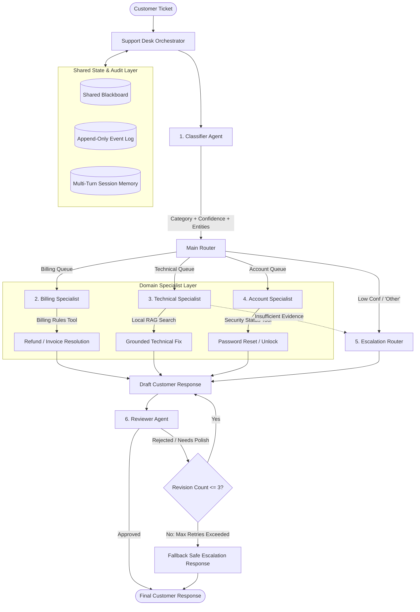

# Enterprise Customer Support Triage and Resolution Desk

**Course:** CSE476 – Agentic AI and Intelligent Automation  
**Assignment:** CA2 – Multi-Agent System  
**Selected Topic:** Group 3 – Enterprise Customer Support Triage and Resolution Desk  
**Target Environment:** Conda environment `cse476` (Python 3.12)

---

## 1. Project Overview

The **Enterprise Customer Support Triage and Resolution Desk** is a collaborative multi-agent AI system designed to automate customer ticket lifecycle management. Unlike simple conversational chatbots, this system implements a genuine **Router-to-Specialists** architecture where specialized agents collaborate through a centralized **Shared Blackboard**, record every transition into an **Append-Only Auditable Event Log**, ground solutions using **Local Document RAG**, enforce business constraints via **Deterministic Python Tools**, and validate all drafted responses through a dedicated **Reviewer Agent** with automated revision loops.

---

## 2. Multi-Agent System Architecture



---

## 3. The Six Specialized Agents

| Agent | Module | Primary Responsibility | Genuine Python Tools |
| :--- | :--- | :--- | :--- |
| **1. Classifier Agent** | `agents/classifier_agent.py` | Classifies tickets into `billing`, `technical`, `account`, or `other`; extracts entities and calculates confidence score. | `extract_ticket_entities()`<br>`calculate_classification_confidence()`<br>`rule_based_category_hint()` |
| **2. Billing Specialist** | `agents/billing_specialist.py` | Resolves payment disputes, duplicate deductions, and refund requests according to company policies. | `check_refund_eligibility()`<br>`verify_invoice_and_payment_status()` |
| **3. Technical Specialist** | `agents/technical_specialist.py` | Resolves error codes, outages, and how-to inquiries grounded in support documents; flags insufficient evidence. | `query_technical_knowledge_base()`<br>`diagnose_error_code()` |
| **4. Account Specialist** | `agents/account_specialist.py` | Resolves account lockout, password resets, and suspicious compromised account notifications. | `verify_account_security_status()`<br>`initiate_secure_password_reset()` |
| **5. Escalation Router** | `agents/escalation_router.py` | Directs tickets to human support tiers when confidence is low (< 0.65), category is 'other', or evidence is lacking. | `evaluate_escalation_criteria()`<br>`generate_escalation_handoff_note()` |
| **6. Reviewer Agent** | `agents/reviewer_agent.py` | Required Group-of-Three component. Evaluates response tone, completeness, safety, and source citations; enforces revisions. | `validate_response_quality()`<br>`check_compliance_and_safety()` |

---

## 4. Shared Memory & Communication

### Shared Blackboard (`memory/blackboard.py`)
All agents communicate by reading and writing to an observable, thread-safe blackboard snapshot holding:
- `ticket_id`, `customer_id`, `customer_message`, `status`
- `classification`: Category, confidence score, extracted entities, rationale
- `routing`: Target queue, routing type (`SPECIALIST` vs `ESCALATION`), rationale
- `specialist_output`: Resolution summary, supporting evidence, `needs_escalation` flag
- `escalation`: Human target tier, priority (`NORMAL`, `HIGH`, `URGENT`), briefing handoff note
- `draft_response`: Proposed response before reviewer inspection
- `review`: Approval status, tone score, completeness score, feedback list, revision count
- `final_response`: Verified, customer-ready text

### Append-Only Event Log (`memory/event_log.py`)
Provides an immutable audit log. Each event records:
- `event_id` (e.g., `EVT-0001`)
- `ticket_id`
- `timestamp` (UTC ISO format)
- `agent` (e.g., `ClassifierAgent`, `TechnicalSpecialist`, `ReviewerAgent`)
- `action` (e.g., `TicketReceived`, `RAGKnowledgeRetrieved`, `ResponseApproved`)
- `status` (`SUCCESS`, `WARNING`, `REJECTED`, `ESCALATED`)
- `details` (payload dictionary)

### Multi-Turn Session Memory (`memory/session_memory.py`)
Maintains conversational context across multiple tickets for the same user, enabling follow-up questions (e.g., *"Which department is handling my refund?"*) without asking the customer to repeat their details.

---

## 5. Local Document-Based RAG

The **Technical Specialist** uses a local semantic vector store (`rag/retriever.py`) that operates on support documents in `knowledge_base/`:
- `troubleshooting_guide.txt`: General troubleshooting, cache clearing, connection drops, memory optimization.
- `error_codes.txt`: Official diagnostic remediation for `ERR-1001`, `ERR-1002`, `ERR-2005`, and `ERR-4030`.
- `api_integration_guide.txt`: REST authentication, API key generation, idempotency keys, webhooks.
- `system_requirements.txt`: Browser support, operating systems, minimum hardware requirements.

### RAG Highlights:
- **Zero External Paid API:** Operates entirely locally using TF-IDF sparse vector representations and cosine similarity via Python's built-in libraries and `numpy`/`scipy`.
- **Sliding-Window Chunking:** Preserves sentence boundaries and groups section headings with contextual text.
- **Strict Evidence Threshold:** When maximum cosine similarity falls below `0.25`, the retriever explicitly outputs `INSUFFICIENT_EVIDENCE`.
- **Hallucination Prevention:** The Technical Specialist refuses to invent solutions and automatically hands off the case to the **Escalation Router**.

---

## 6. Project Directory Structure

```
ca2/
├── .env                              # Environment configuration (active Groq keys)
├── .env.example                      # Configuration template
├── .gitignore
├── config.py                         # System constants and settings
├── main.py                           # CLI and interactive support desk
├── requirements.txt                  # Environment dependencies
├── README.md                         # Complete project documentation
│
├── agents/                           # The 6 specialized agents
│   ├── __init__.py
│   ├── classifier_agent.py
│   ├── billing_specialist.py
│   ├── technical_specialist.py
│   ├── account_specialist.py
│   ├── escalation_router.py
│   └── reviewer_agent.py
│
├── tools/                            # Genuine deterministic Python tools
│   ├── __init__.py
│   ├── classifier_tools.py
│   ├── billing_tools.py
│   ├── technical_tools.py
│   ├── account_tools.py
│   ├── escalation_tools.py
│   └── reviewer_tools.py
│
├── memory/                           # Shared state, auditability, and context
│   ├── __init__.py
│   ├── blackboard.py
│   ├── event_log.py
│   └── session_memory.py
│
├── orchestration/                    # Router-to-Specialists coordinator
│   ├── __init__.py
│   ├── router.py
│   └── workflow.py
│
├── rag/                              # Local vector store & chunking engine
│   ├── __init__.py
│   ├── knowledge_base.py
│   └── retriever.py
│
├── knowledge_base/                   # Support documentation text corpus
│   ├── api_integration_guide.txt
│   ├── error_codes.txt
│   ├── system_requirements.txt
│   └── troubleshooting_guide.txt
│
├── notebooks/                        # Demonstration notebook
│   └── customer_support_demo.ipynb
│
└── tests/                            # Comprehensive Pytest test suite
    ├── __init__.py
    ├── test_agents.py
    ├── test_integration_groq.py
    ├── test_memory.py
    ├── test_rag.py
    ├── test_tools.py
    └── test_workflow.py
```

---

## 7. How to Run the Project

### 1. Activate Environment
Ensure you are using the existing course Conda environment:
```powershell
conda activate cse476
```

### 2. Run the Automated Test Suite
Run the 32 unit and workflow tests:
```powershell
cd "e:\agentic ai\ca2"
pytest -v
```

### 3. Run the Interactive Support Desk CLI
Launch the interactive terminal interface:
```powershell
python main.py
```
Or process a single ticket directly:
```powershell
python main.py --message "My payment was deducted for order ORD-1234, but no confirmation was sent." --audit-log
```

### 4. Run the Demonstration Notebook
Launch Jupyter Notebook to view all 7 demonstration scenarios:
```powershell
jupyter notebook notebooks/customer_support_demo.ipynb
```

---

## 8. Alignment with Official Teacher Specifications

| Specification Area | Earlier Draft / Proposal | Official Teacher Specification (Implemented) | Status |
| :--- | :--- | :--- | :--- |
| **Agent Roster** | SLA Agent, Routing Agent, Resolution Agent, Specialist Agent | Exactly 6 specialized agents: Classifier, Billing Specialist, Technical Specialist, Account Specialist, Escalation Router, Reviewer Agent | **Fully Aligned** |
| **Architecture** | Generic peer-to-peer or pipeline | Strict **Router-to-Specialists** architecture with Central Router | **Fully Aligned** |
| **RAG Scope** | RAG generalized across all agents | RAG specifically dedicated to the **Technical Specialist** | **Fully Aligned** |
| **Billing Logic** | General textual advice | Deterministic Python billing rules tool (`check_refund_eligibility`, `verify_invoice_and_payment_status`) | **Fully Aligned** |
| **Escalation** | Ad-hoc fallback | Formal **Escalation Router** handling low confidence, 'other' category, and insufficient evidence | **Fully Aligned** |
| **Response Review** | Optional review check | Mandatory **Reviewer Agent** with tone, completeness, safety validation, and max retry limits | **Fully Aligned** |
| **Memory** | Ephemeral context | Multi-turn **Session Memory** retaining ticket history across conversations | **Fully Aligned** |
